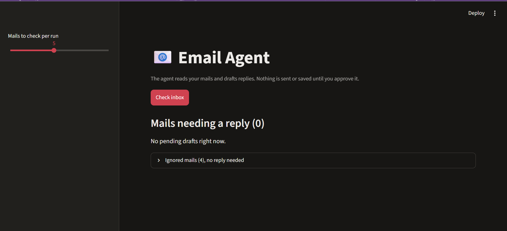

# 📧 AI Email Agent

An agentic AI app that connects to Gmail, reads unread emails, decides which ones need a reply, drafts the reply using your own knowledge base (RAG), and then **sends it or saves it to Gmail Drafts only after you approve it**.

Built with free tools only: Groq, LangGraph, Chroma, Streamlit and the Gmail API.



## What it does

1. Fetches unread emails from Gmail (OAuth, read access)
2. Classifies each email (urgent / query / meeting / newsletter / spam / other) and decides if a reply is needed
3. Looks up relevant info from your own documents using RAG (Chroma + local embeddings)
4. Drafts a reply with an LLM
5. Asks for your approval on every reply:
   - **Terminal version** (`run_graph.py`): `[s]` send now (with a second confirmation), `[d]` save as Gmail draft, `[n]` skip
   - **Streamlit UI** (`ui.py`): edit the draft, then save it to Gmail Drafts or skip
6. Nothing is ever sent without your explicit approval
7. Labels every handled email `AI-Processed` so it is never picked up twice

## Workflow

```
fetch unread mails
      │
  classify (LLM, structured output)
      │
  needs reply? ── no ──→ label AI-Processed
      │ yes
  RAG lookup (Chroma) → draft reply (LLM)
      │
  human approval (terminal: send / draft / skip)
      │
  send mail  OR  save to Gmail Drafts  OR  skip
      │
  label AI-Processed
```

## Tech stack

| Part | Tool |
|---|---|
| LLM | Groq (free tier) via `langchain-groq` |
| Agent workflow | LangGraph (nodes + conditional edges) |
| Structured output | Pydantic |
| Vector DB | Chroma (local) |
| Embeddings | `all-MiniLM-L6-v2` (sentence-transformers, local) |
| Mail | Gmail API (OAuth) |
| UI | Streamlit |

## Project structure

```
email-agent/
├── app/
│   ├── gmail_client.py   # Gmail API: login, fetch, draft, send, label
│   ├── classifier.py     # classify + summarize (structured output)
│   ├── drafter.py        # reply drafting with RAG context
│   ├── rag.py            # Chroma index + retrieval
│   └── graph.py          # LangGraph workflows
├── data/docs/            # your knowledge base (.txt / .md)
├── ui.py                 # Streamlit approval UI
├── run_graph.py          # terminal version (y/n approval)
├── ingest.py             # build the Chroma index from data/docs
├── .env.example
└── requirements.txt
```

## Setup

### 1. Install

```bash
python -m venv .venv
.venv\Scripts\activate          # Windows
pip install -r requirements.txt
```

### 2. Gmail API credentials

1. Create a project in Google Cloud Console and enable the **Gmail API**
2. Configure the OAuth consent screen (External) and add your Gmail as a **Test user**
3. Create an **OAuth client ID** of type **Desktop app**
4. Download the JSON and save it as `credentials.json` in the project root

### 3. Environment variables

Copy `.env.example` to `.env` and fill in:

```
GROQ_API_KEY=your_key_from_console.groq.com
GROQ_MODEL=openai/gpt-oss-20b
USER_NAME=Your Name
```

### 4. Add your knowledge base

Put `.txt` or `.md` files with your info (about you, availability, FAQs) in `data/docs/`, then build the index:

```bash
python ingest.py
```

Run it again whenever the docs change.

### 5. Run

```bash
streamlit run ui.py       # web UI
python run_graph.py       # or the terminal version
```

The first run opens a browser for Google login. After that a `token.json` is stored locally.

> **Permissions:** the app asks for Gmail read, compose, modify and **send** access. If you upgraded from an older version that could only read or draft, delete `token.json` and log in again so Google can grant the new permission.

## Safety

- Nothing is sent automatically: every reply needs your approval
- Sending in the terminal needs two confirmations (`s`, then `y`). Saving a draft or skipping needs one
- Automated mails (newsletters, notifications, spam) are classified as "no reply needed" and are never replied to
- Read the draft and the `To:` address shown before you send. The LLM can still make mistakes
- `credentials.json`, `token.json` and `.env` are in `.gitignore`. Never commit them
- The reply prompt tells the model not to invent facts or commitments

## Roadmap

- [x] Send replies after approval (terminal)
- [ ] Send button in the Streamlit UI
- [ ] Auto-run in the background on a schedule
- [ ] Calendar tool for meeting requests
- [ ] Docker setup